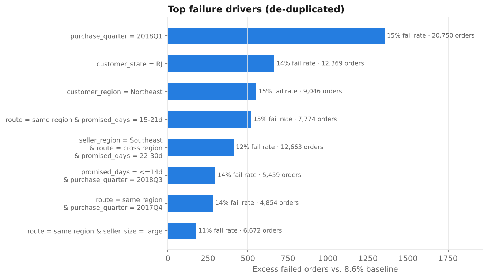
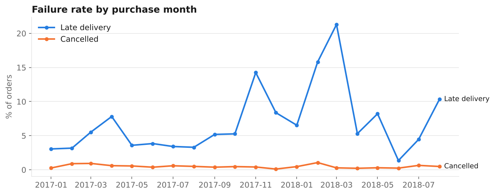
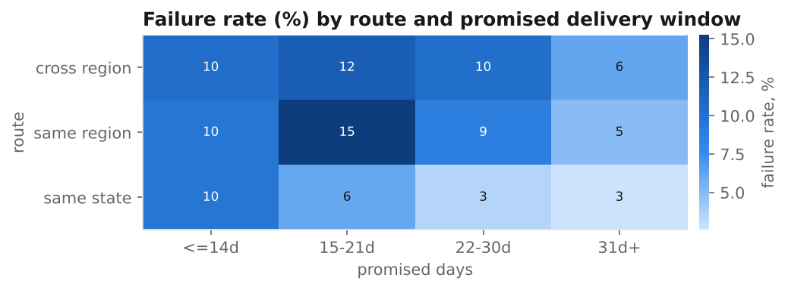
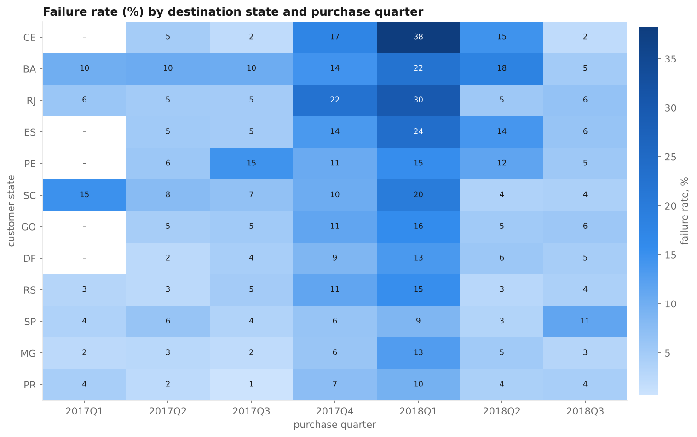

# Order-Failure Root Cause

**Which orders fail, and why?** This is a reusable Python tool that searches every combination of order attributes for the segments that drive failed deliveries. It tests each segment for statistical significance and returns a short, de-duplicated list of drivers that operations can act on.

The tool is demonstrated on ~97K orders from the public [Olist Brazilian e-commerce dataset](https://www.kaggle.com/datasets/olistbr/brazilian-ecommerce).



## Problem
8.6% of resolved orders fail: 8.1% arrive after the promised date and 0.5% are cancelled. A dashboard shows *that* the rate moves. It doesn't show *where* the failures concentrate, or whether a spike comes from one bad segment or a network-wide problem.

## Approach
1. **One row per order** with 16 attributes known at purchase time: destination state and region, seller region, route (same state, same region, or cross region), category, payment type and installments, basket value, freight share, weight, item count, multi-seller flag, promised delivery window, seller size, weekday, and quarter.
2. **Breadth-first search over attribute combinations.** Level 1 scores every `attribute = value` segment. Each further level adds one condition, and only segments that fail above the baseline are expanded. Up to 3 conditions: **11,946 segments** tested in ~10 s.
3. **Statistics, so drivers aren't lucky slices.** Each segment gets a two-proportion z-test against the rest of the orders, with a Benjamini–Hochberg correction across all tests. A segment must also show lift ≥ 1.25. A combination must beat each of its sub-segments by ≥ 10%, so it's a real interaction and not just a parent driver restated.
4. **Ranking by impact.** Segments are ranked by *excess failures*, the failed orders that wouldn't have happened at the baseline rate. Overlapping segments are then de-duplicated.

## Results
The top 8 drivers cover 59% of orders but 78% of failures. Failures are a **timing and lane problem**, not a product or payment one:

| Finding | Evidence | Suggested action |
|---|---|---|
| **Network-wide peaks.** Late rate jumps to 14% in Nov 2017 and 21% in Mar 2018 | Q1 2018 fails 15% (1.8× baseline), and 25 of 27 states are above baseline that quarter | Add a buffer to promised dates in peak weeks; this needs a capacity plan, not segment fixes |
| **Rio de Janeiro and the Northeast** | RJ fails 14% and the Northeast 15%, vs 7–8% for the South and Center-West | Review carrier performance on these destinations |
| **The promise is wrong on one lane** | Same-region orders promised 15–21 days fail 15%. For RJ and ES buyers on that lane it's 22–24% | Recalibrate the delivery-date estimate for Southeast → RJ/ES |
| **No driver** in category, basket value, payment type, installments, weight, freight share, or item count | None passes the significance and lift checks | Stop investigating product/checkout causes for late delivery |

734 more cancelled orders have no item data, so no attribute can explain them. They're reported separately rather than allowed to pose as a "segment".

<p>


</p>



## Run it
```bash
pip install -r requirements.txt
bash data/download.sh                      # or download from Kaggle into data/
python run_analysis.py --data-dir data --out-dir reports
python run_analysis.py --max-depth 2 --min-support 500   # tune depth / minimum segment size
pytest -q                                  # checks the search finds a planted interaction and ignores noise
```

Outputs: `reports/top_drivers.csv`, `reports/significant_segments.csv` (all 668 drivers), and the figures above.

**Reuse on your own data:** `bfs_search(df, attributes, target="failed")` works on any table with a 0/1 outcome and categorical columns, such as failed payments, churned users, or crashed sessions.

## Repo layout
```
src/rootcause/data.py     # load Olist, build order-level attributes + failure flag
src/rootcause/search.py   # BFS over attribute combinations + statistical tests
src/rootcause/report.py   # de-duplication and figures
run_analysis.py           # CLI entry point
tests/test_search.py      # synthetic tests (planted interaction, noise, min support)
```

<sub>Method adapted from my work on order net-fail rates in quick-commerce, rebuilt from scratch on public data. No employer code or data is used.</sub>
